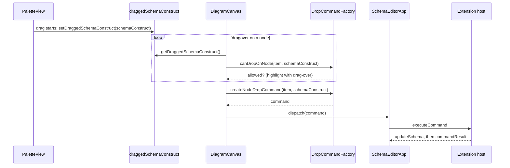

# Purpose

Drag and drop from the palette is the only way to add schema constructs to a schema (see [UX concept](ux-concept.md#core-rules)). This document describes how a drop becomes a command: who is responsible for what, the order of events, the rules for which schema construct can be dropped on which node, and the values that new schema constructs get. The palette itself is described in [Editor](editor.md#palette), the commands in [Commands](commands.md).

# Responsibilities

Drag and drop is split into four parts, so that new schema constructs and rules can be added without touching the event handling:

| Part                                                  | Responsibility                                                                                                                                                                                                                            |
| ----------------------------------------------------- | ----------------------------------------------------------------------------------------------------------------------------------------------------------------------------------------------------------------------------------------- |
| Palette (`palette/`: `PaletteView`, `paletteEntries`) | What is dragged: shows the schema constructs and starts the drag.                                                                                                                                                                         |
| Canvas (`canvas/canvasDrop.ts`)                       | Where it is dropped: finds the node under the pointer, shows the highlight and hands the drop to the drop rules.                                                                                                                          |
| Drag and drop (`dragAndDrop/`)                        | What is dragged and what a drop does: the schema constructs, the dragged schema construct, and the drop rules (`DropCommandFactory`), which decide whether a drop is allowed and which command it creates. All placement rules live here. |
| Extension host                                        | Validates and executes the command and sends the updated schema back (see [Persistence](persistence.md)).                                                                                                                                 |

The canvas owns the drop rules: it creates the `DropCommandFactory`, updates its list of names whenever it draws a new schema, and hands the command of a drop to `SchemaEditorApp` in `main.ts`, which sends it.[^webview-main] The app knows nothing about drops, and the canvas knows no placement rule.

# Flow

1. **Drag start.** When the user starts dragging a palette item, `PaletteView` remembers which schema construct (for example `element`) is being dragged, with `setDraggedSchemaConstruct()` in `dragAndDrop/draggedSchemaConstruct.ts`. The palette and the canvas are in the same webview, so the canvas reads it from there. The drag data of the browser (`dataTransfer`) is not used: during `dragover`, Chromium does not let the drop target read it, so it could not decide which nodes to highlight. `PaletteView` also sets `effectAllowed` to `copy`. Disabled items (`any`) are not draggable. When the drag ends, the dragged schema construct is cleared.[^palette-view][^palette-items]
2. **Drag over.** The canvas finds the nearest element with `data-item-id`, reads the dragged schema construct and asks the drop rules. If the drop is allowed, it calls `preventDefault()` and adds the CSS class `drag-over`, which highlights the node's shape; otherwise it removes the class.[^renderer]
3. **Drag leave.** The class is only removed when the pointer really leaves the node: if the element under the pointer or the `relatedTarget` is still inside the node, the event is ignored. Without this check, the highlight flickers when the pointer moves between the shapes and texts of one node.
4. **Drop.** The canvas checks the drop again, removes the highlight and clears the dragged schema construct.
5. **Command.** The canvas asks `DropCommandFactory` for the command and hands it to the app, which sends it as `{ command: "executeCommand", data: command }`. If the factory returns `null`, the app shows the error "Drop of '<schema construct>' is not supported for '<node name>'".[^webview-main]

The extension host validates every command again. The check in the webview is only for immediate feedback; a drop that passes it can still fail, for example because of a name conflict inside the parent, and the error is then shown like any other command error (see [Messaging](messaging.md)).

# Drop rules

The node kinds in the table are:

- **Schema root:** the node with the ID `/schema`.
- **Compositor:** a `sequence`, `choice` or `all` node.
- **Element:** any element node. "With anonymous complex type" and "with anonymous simple type" refer to an element whose type is defined inline.
- **Complex type, simple type:** a named type node. A simple type counts as a restriction if it restricts a named base type; list and union types do not.
- **Group:** a top-level group definition, not a group reference.

| Schema construct      | Target                                                                                        | Command                                                                                                                    |
| --------------------- | --------------------------------------------------------------------------------------------- | -------------------------------------------------------------------------------------------------------------------------- |
| element               | schema root, compositor                                                                       | `addElement` with a generated name and type `xs:string`                                                                    |
| attribute             | schema root, named complex type, also a derived one                                           | `addAttribute` with a generated name and type `xs:string`                                                                  |
|                       | element with anonymous complex type                                                           | `addAttribute` on the anonymous complex type                                                                               |
| group                 | schema root                                                                                   | `addGroup` with a generated name and content model `sequence` (a definition; references cannot be dropped)                 |
| simpleType            | schema root                                                                                   | `addSimpleType` with a generated name and base type `xs:string`                                                            |
|                       | element                                                                                       | `addSimpleType` without name: an anonymous simple type that replaces the element's type                                    |
| complexType           | schema root                                                                                   | `addComplexType` with a generated name and content model `sequence`                                                        |
|                       | element                                                                                       | `addComplexType` without name: an anonymous complex type that replaces the element's type                                  |
| sequence, choice, all | complex type                                                                                  | `modifyComplexType` with the new content model                                                                             |
|                       | element with anonymous complex type                                                           | `modifyComplexType` on the anonymous complex type                                                                          |
|                       | other element                                                                                 | `addComplexType` with the content model: a new anonymous complex type                                                      |
|                       | group                                                                                         | `modifyGroup` with the new content model                                                                                   |
| restriction           | schema root                                                                                   | `addSimpleType` with a generated name and base type `xs:string`                                                            |
|                       | element with anonymous complex type                                                           | `modifyComplexType` with `derivationKind: "restriction"`                                                                   |
|                       | element with anonymous simple type                                                            | `modifySimpleType` on the anonymous simple type                                                                            |
|                       | other element                                                                                 | `addSimpleType` without name, based on the element's type                                                                  |
|                       | simple type                                                                                   | `modifySimpleType`                                                                                                         |
|                       | complex type                                                                                  | `modifyComplexType` with `derivationKind: "restriction"`                                                                   |
| extension             | schema root                                                                                   | `addComplexType` with a generated name, content model `sequence`, base type `xs:anyType` and `derivationKind: "extension"` |
|                       | element with anonymous complex type                                                           | `modifyComplexType` with `derivationKind: "extension"`                                                                     |
|                       | other element                                                                                 | `addComplexType` without name, derived by extension from the element's type                                                |
|                       | complex type                                                                                  | `modifyComplexType` with `derivationKind: "extension"`                                                                     |
| facets (all twelve)   | simple type derived by restriction, element with anonymous simple type derived by restriction | `modifySimpleType` with the existing facets plus the dropped one                                                           |
| any                   | -                                                                                             | not supported (disabled in the palette)                                                                                    |

Every other combination returns `null`. In particular, nothing can be dropped on attributes or group references, and only elements can be dropped on compositors. A compositor drop on a type that already has one replaces the compositor and moves its particles into the new one (see [Commands](commands.md#complex-types)).[^drop-factory] In a derived complex type, `addAttribute` puts the attribute into the `xs:extension` or `xs:restriction` (see [Commands](commands.md#attributes)). In a restriction, the dropped attribute is not checked against the base type, so it usually makes the schema invalid (see [Known issues](known-issues.md#attributes-in-a-restriction-are-not-checked-against-the-base-type)).

# Defaults

**Names.** New named schema constructs get the names `Element1`, `Attribute1`, `Group1`, `SimpleType1` and `ComplexType1`; the number is the lowest one that is not in use. The factory keeps the names of all top-level elements, attributes, simple types, complex types, groups and attribute groups, refreshed on every schema update. A name is reserved as soon as a command is created, so two drops before the next update do not get the same name; the checks during `dragover` do not reserve names.[^drop-factory] Names of local elements and attributes are not considered, so a drop can repeat a local name of the drop target (see [Known issues](known-issues.md#generated-names-ignore-local-names-in-the-drop-target)).

**Types.** New elements and attributes get the type `xs:string`. New complex types get the content model `sequence`.

**Base types.** For a restriction or extension, the base type is the base type of the node's derivation, or the type that an element names. Without one, a restriction uses `xs:anyType` for complex types and elements with anonymous complex types, and `xs:string` otherwise; an extension uses `xs:anyType`.[^drop-type-helpers]

**Facets.** A dropped facet gets a default value. A dropped enumeration or pattern adds its value to the existing ones; every other facet overwrites the facet if it already exists:

| Facet                                                               | Default                                                                                                                   |
| ------------------------------------------------------------------- | ------------------------------------------------------------------------------------------------------------------------- |
| `enumeration`                                                       | `value`, or `value2`, `value3`, … with the lowest number that is not in use yet                                           |
| `pattern`                                                           | `.*` if the restriction has no pattern yet; otherwise `[^a-zA-Z0-9\s]*`, also if the restriction already has this pattern |
| `length`, `minLength`, `maxLength`, `totalDigits`, `fractionDigits` | `1`                                                                                                                       |
| `minInclusive`, `maxInclusive`, `minExclusive`, `maxExclusive`      | `0`                                                                                                                       |
| `whiteSpace`                                                        | `preserve`                                                                                                                |

Patterns of one restriction are alternatives (see [UX concept](ux-concept.md#multiple-patterns)), so every added pattern widens the type. `.*` keeps a type without patterns as it was, apart from values with line breaks; `[^a-zA-Z0-9\s]*` only adds values without letters, digits and whitespace, until the user edits it. Facets are not checked against the base type (see [Known issues](known-issues.md#facets-are-not-checked-against-the-base-type)).

# Adding a draggable schema construct

1. Add the schema construct to `DraggableSchemaConstruct` in `dragAndDrop/`.
2. Add a palette entry in `palette/paletteEntries.ts` (group, label, Codicon, tooltip), if users should drag it.
3. Add the placement rules and the command to `DropCommandFactory`, or to `TypeDropCommands` for types and facets. The canvas uses the same method for the highlight, so hover feedback and drop stay consistent.
4. If the command is new, add it as described in [Commands](commands.md#files).
5. Add tests: placement and payloads in `DropCommandFactory.test.ts`, drag events in `canvas/canvasDrop.test.ts` only if the event handling changes.[^drop-factory-tests]

The tests that cover drag and drop are `DropCommandFactory.test.ts` (rules, payloads, names, base types, facets), `canvas/canvasDrop.test.ts` (highlight, drop, drag leave guard), `canvas/DiagramCanvas.test.ts` (drops become commands), `dragAndDrop/draggedSchemaConstruct.test.ts` and `PaletteView.test.ts` (drag payload and cleanup).

[^palette-items]: Palette entries

[^palette-view]: PaletteView

[^renderer]: Drop handling of the canvas

[^webview-main]: Webview entry point (SchemaEditorApp)

[^drop-factory]: DropCommandFactory

[^drop-type-helpers]: Drop helpers for types, derivations and facets

[^drop-factory-tests]: DropCommandFactory tests
